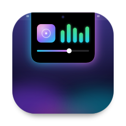
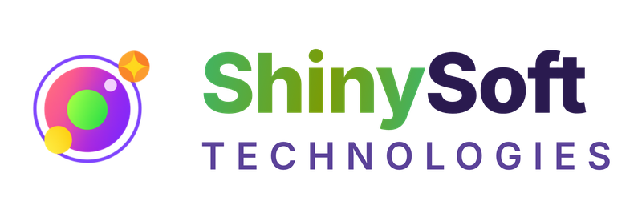
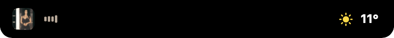
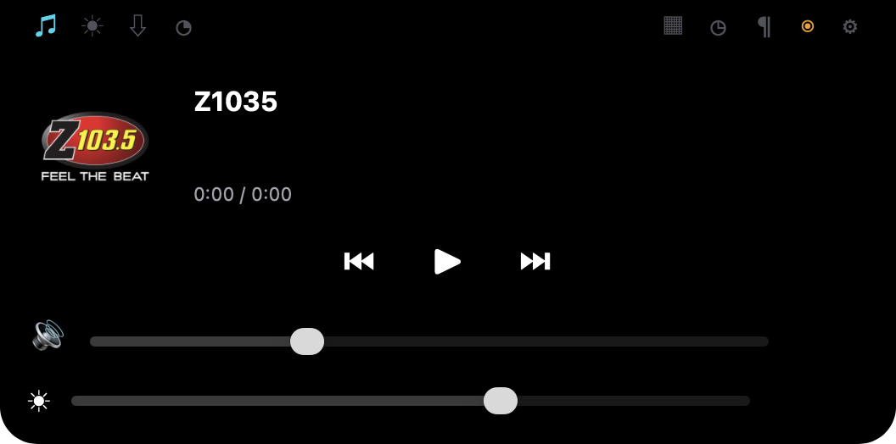
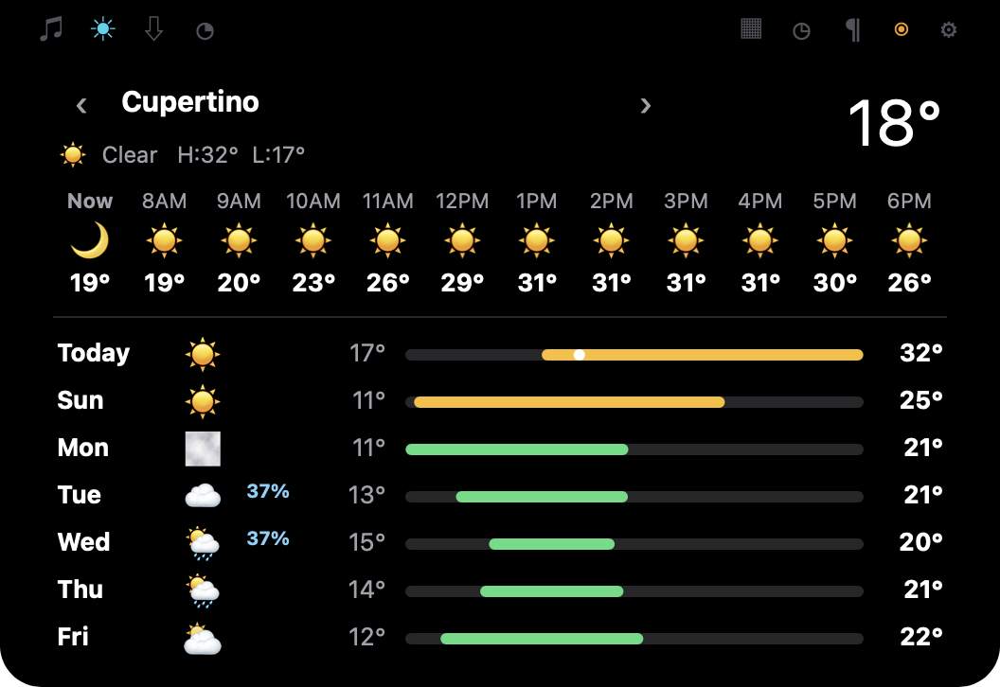
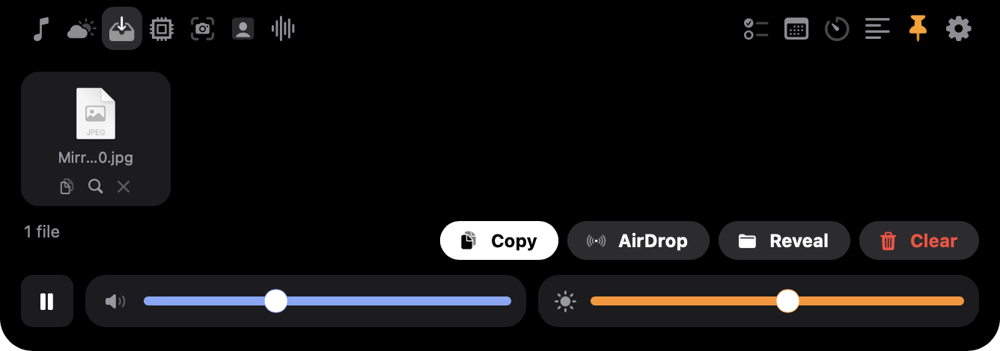
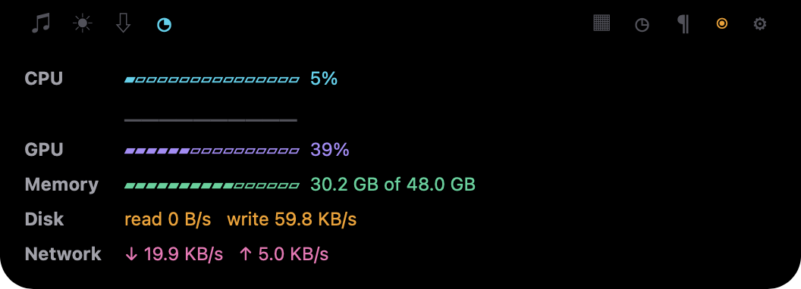
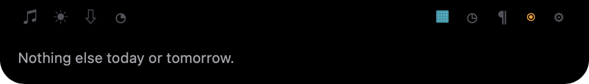
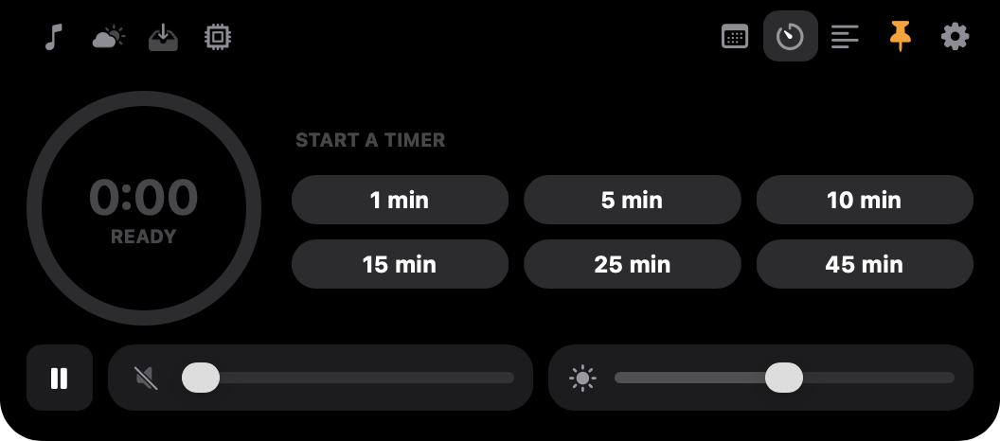
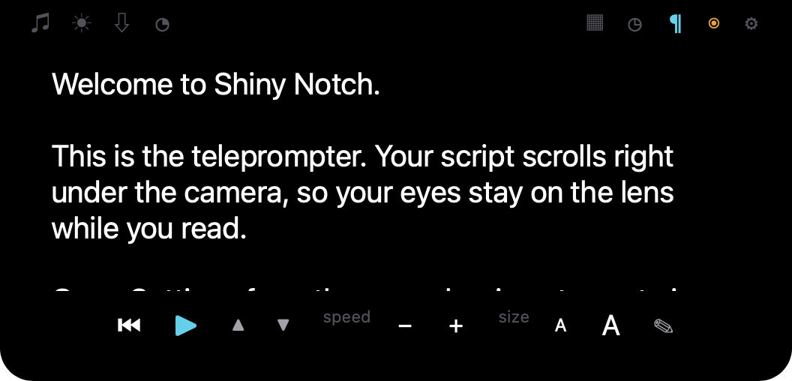

<p align="center">
  
</p>

# Shiny Notch

A menu-bar app for macOS that turns the MacBook camera notch into a live panel. It's built with .NET MAUI on the AppKit head ([maui-labs](https://github.com/dotnet/maui-labs)) and Shiny Controls' `NotchView` / `INotchWindowService`.

Hover the notch to open it, and move away to let it fold back into the camera. Apple silicon only.

<p align="center">
  <a href="https://shinysoft.biz">
    <picture>
      <source media="(prefers-color-scheme: dark)" srcset="docs/brand/shinysoft-logo-dark.png" />
      
    </picture>
  </a>
  <br />
  <sub>Designed, built and maintained by <a href="https://shinysoft.biz"><b>ShinySoft Technologies</b></a> · powered by <a href="https://www.shinylib.net"><b>Shiny .NET</b></a> open source</sub>
</p>

<p align="center">
  <a href="https://github.com/ShinySoftware/ShinyNotch/releases/latest"></a>
  
  <a href="https://www.shinylib.net"></a>
  <a href="LICENSE.md"></a>
</p>

> **Shiny Notch is not open source.** The code is published so you can read it, learn from it and build it for yourself, but you may not copy, repackage, rebrand or redistribute it. See [License](#license). The Shiny libraries it's built on *are* open source (MIT); see [Built on Shiny open source](#built-on-shiny-open-source).

## Download

Signed and notarized builds are on the [Releases](https://github.com/ShinySoftware/ShinyNotch/releases) page. These are the only official builds. If you got Shiny Notch from anywhere else, it isn't ours.

<p align="center">
  
</p>

## Features

### Peek

While collapsed, the notch shows a "wing" either side of the camera:
- **Left:** what's playing: the artwork, and bars in the artwork's colour (flat when paused).
- **Right:** a running timer, a meeting starting in the next 15 minutes, or the weather where you are, in that order.

With nothing to show, the notch disappears into the camera housing.

### Now Playing
Artwork, title, a scrubber and previous/play/next for Apple Music and Spotify, on a card tinted with the artwork's colour.



### Weather
Like the iOS widget: the conditions now, the next twelve hours, and the week. Each day's low-to-high bar sits on the week's range, and today's bar has a dot at the current temperature. It works from where you are, or any cities you add in Settings; switch between them with ‹ ›. Temperatures are °C or °F, automatic by region: change it in Settings, or tap the temperature to flip it.



### File Tray
Drop files onto the notch to shelve them. Copy them back out (⌘V in Finder pastes them), AirDrop them, reveal or open them, or clear the tray. Files that move or are deleted drop off on their own.



### System
CPU, GPU and memory as rings, a chart of the last 24 seconds of CPU, and network and disk rates, updated once a second while the tab is open.



### Calendar
The rest of today and tomorrow, from every calendar you have.



### Timer
A ring that drains as the countdown runs, presets from 1 to 45 minutes, plus +1 min, pause and cancel. The countdown shows in the peek, and the notch chimes and opens for a few seconds when it ends.



### Teleprompter
Your script scrolls right under the camera, so you read while looking at the lens. There's play/pause, nudge, speed and text size, and the notch stays open while it runs. Edit the script in Settings.



### Controls on every tab
Play/pause, volume and display brightness sit under every tab, and follow the keys and Control Centre.

### Volume and brightness HUD
Changes from the keys or Control Centre flash in the notch.


### And
- **Pin** (⦿) keeps the panel open.
- **Open at login**, from the menu-bar menu (a checkmark) or Settings. The first time, macOS usually asks you to approve it in System Settings ▸ General ▸ Login Items; the app says so and opens that page. If you turn it off there later, the app shows that too, rather than a switch that's lying.
- **Settings** (⚙ in the panel, or the menu-bar icon) holds the teleprompter script, weather places and units, the HUD toggles, permissions and open at login.
- It's an agent app (`LSUIElement`) with no Dock icon; quit it from the menu-bar icon.

## Build and run

```bash
dotnet build
open src/ShinyNotch/bin/Debug/net10.0-macos/osx-arm64/ShinyNotch.app
```

For a release build:

```bash
dotnet build -c Release
open src/ShinyNotch/bin/Release/net10.0-macos/osx-arm64/ShinyNotch.app
```

Debug builds accept `--open <Media|Weather|Tray|Stats|Calendar|Timer|Prompter>` to start with the panel pinned open on a tab, which makes the UI drivable without a mouse:

```bash
src/ShinyNotch/bin/Debug/net10.0-macos/osx-arm64/ShinyNotch.app/Contents/MacOS/ShinyNotch --open Weather
```

The icon's source is `src/ShinyNotch/Resources/AppIcon/appicon.svg`. After editing it, re-render the PNG the build uses:

```bash
rsvg-convert -w 1024 -h 1024 src/ShinyNotch/Resources/AppIcon/appicon.svg -o src/ShinyNotch/Resources/AppIcon/appicon.png
```

## Libraries

| Package | Version | Used for |
|---|---|---|
| [Microsoft.Maui.Controls](https://www.nuget.org/packages/Microsoft.Maui.Controls) | 10.0.100 | The UI framework |
| [Microsoft.Maui.Platforms.MacOS](https://github.com/dotnet/maui-labs) | 0.1.0-preview.13 | .NET MAUI on native AppKit (`net10.0-macos`), not Mac Catalyst |
| [Microsoft.Maui.Platforms.MacOS.Essentials](https://github.com/dotnet/maui-labs) | 0.1.0-preview.13 | MAUI Essentials for the AppKit head |
| [Shiny.Core](https://www.nuget.org/packages/Shiny.Core) | 6.3.1-beta-0001 | `IAppStartupInstaller`: open at login (an `SMAppService` login item), with the approval and turned-off states |
| [Shiny.Calendar](https://www.nuget.org/packages/Shiny.Calendar) | 6.3.1-beta-0001 | The Calendar tab and the meeting peek: calendars and today's and tomorrow's events, with permissions through Shiny.Core |
| [Shiny.Maui.Controls](https://www.nuget.org/packages/Shiny.Maui.Controls) | 1.9.0-beta-0004 | `NotchView`, the surface that morphs to fit its content |
| [Shiny.Maui.Controls.Desktop](https://www.nuget.org/packages/Shiny.Maui.Controls.Desktop) | 1.9.0-beta-0004 | `INotchWindowService` (the notch window, hover tracking, camera cut-out size), the menu-bar tray icon, and window-level file drop |
| [Microsoft.Maui.DevFlow.Agent](https://github.com/dotnet/maui-labs) | 0.1.0-preview.13 | Debug builds only: UI inspection and automation |

| Apple framework / service | Used for |
|---|---|
| AppKit (`NSAppleScript`, `NSWorkspace`, `NSPasteboard`, `NSSharingService`) | Now Playing in Music and Spotify; the file tray's copy, reveal, open and AirDrop |
| CoreAudio / AudioToolbox | Output volume and mute |
| DisplayServices (private) | Built-in display brightness; there is no public API on Apple silicon |
| IOKit, mach `host_statistics`, `sysctl`, `getifaddrs` | GPU utilisation, disk bytes, CPU and memory, network bytes |
| EventKit | Calendar events |
| CoreLocation (`CLLocationManager`, `CLGeocoder`) | Where you are for the weather, and its name |
| [Open-Meteo](https://open-meteo.com) | Forecasts and city search: free, no API key |

## Permissions

| Feature | Asks for | Notes |
|---|---|---|
| Now Playing | Automation (Music, Spotify) | Asked once per player, the first time it's running. A player that isn't running is never contacted, because asking it would launch it. |
| Weather | Location | Only when "Show the weather where I am" is on. Cities you add need nothing. |
| Calendar | Calendars, full access | From the Calendar tab or Settings. |
| Everything else | nothing | |

## How it works

- **Low power.** Nothing polls while nothing changes. Music and Spotify announce every play, pause and track change in a distributed notification; CoreAudio listeners report volume, mute and output-device changes; DisplayServices reports brightness. The notch's clock ticks once a second only while something on screen counts seconds (a running timer, a playing track's position, the System tab) and once a minute otherwise. A countdown is a single timer set for its end.
- **The look** is Apple's dark system palette, SF Symbols (drawn once into cached images, so no icon assets ship), and Maui.Graphics drawing for the rings, bars and charts, which repaint in place without rebuilding anything.

- `NotchController` runs the notch in one of three modes (peek, panel, HUD). It rebuilds the content when its structure changes and updates text in place otherwise. The AppKit head never creates native views for children added to an on-screen layout, so a content swap is a fresh page, and so is a change to the Settings page's lists.
- **Now Playing** uses AppleScript, not MediaRemote. Since macOS 15.4 the system-wide now-playing API returns nothing to apps without an Apple entitlement, so only Music and Spotify are seen.
- **Weather** comes from Open-Meteo, which converts units server-side, so switching °C/°F refetches. Forecasts are cached for 20 minutes per place.
- **Text entry** lives in Settings, an ordinary window. The notch window is borderless and can never take keyboard focus.

## Known limits

- Now Playing only sees Apple Music and Spotify (see above).
- Brightness is the built-in display only; most external monitors don't report it.
- Open at login registers the app wherever it is when you switch it on. Move it to `/Applications` first, or the login item points at the old location.
- Files can't be dragged *out* of the tray yet (the AppKit head has no drag source). Use Copy, then paste in Finder.

## Built on Shiny open source

Shiny Notch is a showcase for **[Shiny .NET](https://www.shinylib.net)**, the free, MIT-licensed family of libraries for .NET MAUI, Blazor, ASP.NET Core and native apps that ShinySoft Technologies maintains. They supply the device, background, data and UI layers so an app can concentrate on what it does. The notch itself, the menu-bar icon, open at login and the calendar all come from Shiny packages anyone can use in their own apps.

| Shiny library | What Shiny Notch uses it for | Docs | Source |
|---|---|---|---|
| **Shiny.Maui.Controls** | `NotchView`: the black surface that grows out of the camera housing and morphs to fit the peek, the panel and the HUD | [shinylib.net/controls](https://www.shinylib.net/controls/) | [shinyorg/controls](https://github.com/shinyorg/controls) |
| **Shiny.Maui.Controls.Desktop** | `INotchWindowService` (the borderless notch window, hover tracking and the camera cut-out's size), the menu-bar tray icon, and file drop onto the tray | [Desktop controls](https://www.shinylib.net/controls/trayicon/) | [shinyorg/controls](https://github.com/shinyorg/controls) |
| **Shiny.Core** | Hosting and DI, platform permissions, and `IAppStartupInstaller` for open at login | [Core](https://www.shinylib.net/client/core/) | [shinyorg/shiny](https://github.com/shinyorg/shiny) |
| **Shiny.Calendar** | Every calendar you have, and the events in the Calendar tab and the "meeting soon" peek | [Calendar](https://www.shinylib.net/client/calendarstore/) | [shinyorg/shiny](https://github.com/shinyorg/shiny) |

Shiny Notch also runs on **[.NET MAUI for macOS (AppKit)](https://github.com/dotnet/maui-labs)**, the native AppKit backend for .NET MAUI (not Mac Catalyst). Shiny also maintains community MAUI backends for macOS and Apple TV in [mauiplatforms](https://github.com/shinyorg/mauiplatforms).

### More from Shiny

If you're building with .NET, the rest of the Shiny ecosystem is free to use:

- **Foundation:** [Mediator](https://www.shinylib.net/mediator/), [Actors](https://www.shinylib.net/actors/), [Dependency Injection](https://www.shinylib.net/di/), [Reflector](https://www.shinylib.net/reflector/), [Localization Generator](https://www.shinylib.net/localizegen/)
- **Hardware and connectivity:** [BluetoothLE](https://www.shinylib.net/client/ble/), [BLE Hosting](https://www.shinylib.net/client/blehosting/), [Beacons](https://www.shinylib.net/client/beacons/), [Locations](https://www.shinylib.net/client/locations/gps), [OBD](https://www.shinylib.net/obd/), [Network Discovery](https://www.shinylib.net/client/discovery/), [Wi-Fi](https://www.shinylib.net/client/wifi/)
- **Device data:** [Music](https://www.shinylib.net/music/), [Health](https://www.shinylib.net/health/), [Contacts](https://www.shinylib.net/client/contactstore/), [Calendar](https://www.shinylib.net/client/calendarstore/), [App Store](https://www.shinylib.net/client/appstore/)
- **AI:** [AI Conversations](https://www.shinylib.net/aiconversation/), [Speech](https://www.shinylib.net/speech/)
- **Background:** [Jobs](https://www.shinylib.net/client/jobs/), [Local Notifications](https://www.shinylib.net/client/notifications/), [Push](https://www.shinylib.net/client/push/), [HTTP Transfers](https://www.shinylib.net/client/httptransfers/)
- **UI:** [80+ MAUI and Blazor controls](https://www.shinylib.net/controls/), [MAUI Shell](https://www.shinylib.net/mauishell/)
- **Data and server:** [DocumentDb](https://www.shinylib.net/documentdb/), [Data Sync](https://www.shinylib.net/client/datasync/), [Stores](https://www.shinylib.net/stores/), [HTTP Server](https://www.shinylib.net/httpserver/), [ASP.NET Extensions](https://www.shinylib.net/aspnet/)

Browse everything at **[shinylib.net](https://www.shinylib.net)** or on GitHub at **[github.com/shinyorg](https://github.com/shinyorg)**. Packages are on [NuGet](https://www.nuget.org/profiles/aritchie).

## About ShinySoft Technologies

<p align="center">
  <a href="https://shinysoft.biz">
    <picture>
      <source media="(prefers-color-scheme: dark)" srcset="docs/brand/shinysoft-logo-dark.png" />
      
    </picture>
  </a>
</p>

Shiny Notch was designed and built by **[ShinySoft Technologies](https://shinysoft.biz)**, the company behind Shiny .NET. We've spent 25+ years shipping software for people who work away from a desk: fleets, warehouses, job sites, hospitals and connected hardware. We build apps like this one for clients, and we maintain the open-source libraries that make them possible.

| Engagement | What you get |
|---|---|
| **[Fractional CTO](https://shinysoft.biz/services/)** | Senior technical leadership without a full-time hire: architecture, roadmap, build-vs-buy, hiring and code review |
| **[Team Augmentation](https://shinysoft.biz/services/)** | Senior engineers who ship from day one, unblock stalled or inherited codebases, and leave standards that last |
| **[Idea to Product](https://shinysoft.biz/services/)** | Discovery and analysis that turn a rough concept into a scoped, costed, buildable plan |

What we build:

- **Mobile and desktop with .NET MAUI:** iOS, Android, Windows and macOS, including native AppKit apps like this one
- **IoT and Bluetooth:** BLE central and peripheral, device fleets and hardware integration
- **Fleet and field operations:** location tracking, geofencing and telematics where connectivity isn't guaranteed
- **Cloud and web:** the ASP.NET Core services behind the device
- **Modernization:** legacy .NET Framework and Xamarin apps moved onto current platforms
- **AI:** practical, measured, and your data stays yours

Want something like Shiny Notch for your product or team? **[shinysoft.biz](https://shinysoft.biz)** · **[allan@shinysoft.biz](mailto:allan@shinysoft.biz)** · [LinkedIn](https://www.linkedin.com/company/shiny-soft) · [BlueSky](https://bsky.app/profile/shinylib.net) · [YouTube](https://www.youtube.com/@GoneDotnet)

## License

**Copyright © 2026 ShinySoft Technologies. All rights reserved.**

Shiny Notch is **source-available, not open source**. The full terms are in [LICENSE.md](LICENSE.md). In short:

| You may | You may not |
|---|---|
| Read and study the source code | Copy the app, or substantial parts of it, into another product |
| Build and run it on your own Macs for your own personal, non-commercial use | Repackage, rebrand, rename or re-sign it and distribute it |
| Download and use the official builds from [Releases](https://github.com/ShinySoftware/ShinyNotch/releases) | Publish it, or anything derived from it, to the Mac App Store, Setapp, Homebrew or any other channel |
| Fork on GitHub only to send a pull request back to this repository | Sell it, bundle it, or offer it as a hosted or paid service |
| Report issues and suggest features | Remove or change the ShinySoft Technologies name, logo, copyright or license notices |

"Shiny Notch", "ShinySoft Technologies" and the ShinySoft and Shiny Notch logos are trademarks of ShinySoft Technologies and are not licensed for your use.

The **Shiny .NET libraries** Shiny Notch depends on are separate projects under the [MIT license](https://github.com/shinyorg/shiny/blob/v5/LICENSE.md), and you're free to use them in your own apps. Other third-party components keep their own licenses. This license covers only the Shiny Notch application.

For commercial licensing, white-labelling or a custom build, contact [allan@shinysoft.biz](mailto:allan@shinysoft.biz).

<p align="center">
  <sub>Made with ✨ by <a href="https://shinysoft.biz">ShinySoft Technologies</a> · Ontario, Canada</sub>
</p>
